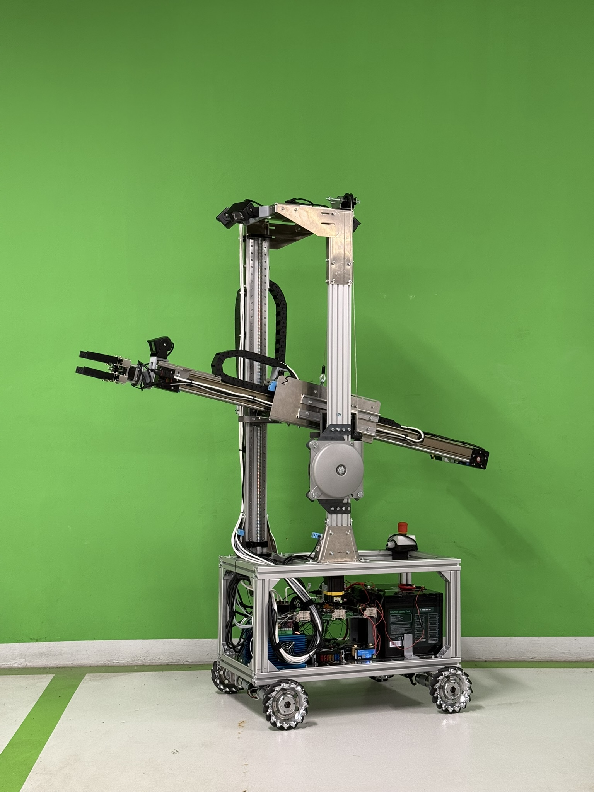
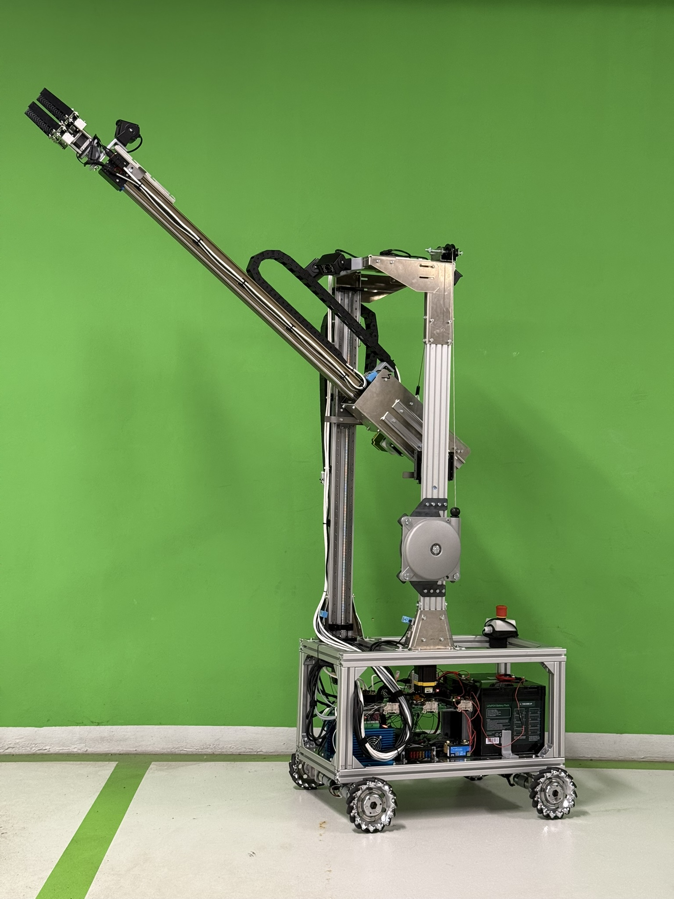

# ObotX

ObotX is an open-source mobile manipulator with a mecanum base, two vertical
Z axes, a horizontal X axis and a four-finger electric gripper.

This repository contains the bill of materials, electrical diagram, firmware
and Raspberry Pi control software required to reproduce and commission the
robot. The customer's external control software is not included.

  
  

  <a href="media/obotx-demo.mp4"><strong>Watch the ObotX demonstration video</strong></a>

## Build and commissioning order

1. Purchase the parts from the [main BOM](hardware/bom/bom.csv) and
   [mechanical BOM](hardware/bom/mechanical-bom.csv).
2. Build the robot using the [mechanical assembly drawings](docs/assembly/README.md).
3. Wire the robot according to the
   [electrical diagram](hardware/wiring/ObotX_electrical_diagram.pdf).
4. Configure and commission the
   [battery system](docs/power/victron-battery-commissioning.md).
5. Configure the [closed-loop stepper drivers](software/stm32_arm/docs/zdm-2ha865-parameters.md).
6. Flash the [ARM](software/stm32_arm/README.md) and
   [BASE](software/stm32_base/README.md) controllers.
7. Install the [Raspberry Pi software](software/rpi/INSTALL.md) and configure
   the [network connection](software/rpi/docs/network-connection.md).
8. Complete the [commissioning checklist](docs/testing/commissioning-checklist.md)
   before placing the robot on the floor or attaching a payload.

## Documentation

Use the [documentation index](docs/README.md) to find the instructions for each
subsystem.

## Safety

Keep the physical emergency stop accessible. Support axes that can fall when
motor power is removed. Begin motor tests unloaded and with the drive wheels
raised. Never use the browser, Wi-Fi, Ethernet, camera video, BatteryProtect or
software STOP as the only emergency-stop function.

Do not commit passwords, Bluetooth encryption keys, private configuration,
invoices, contracts or personal/customer data.
