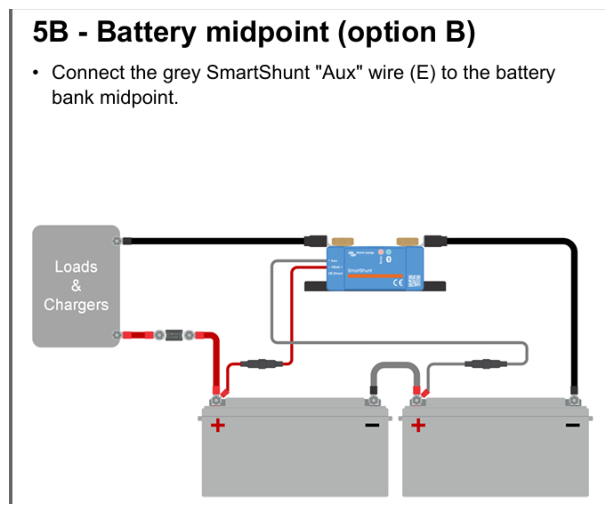

# Victron BatteryProtect 65 and SmartShunt Commissioning

This procedure applies to two 12.8 V, 50 Ah LiFePO4 batteries connected in
series.

This procedure covers:

- first charging and balancing of both 12.8 V batteries,
- normal charging with a FOXSUR FPT-250,
- programming a Victron BatteryProtect 12/24 V 65 A with the `PROG` pin,
- connecting a Victron SmartShunt,
- first connection through Bluetooth in VictronConnect,
- initial SmartShunt parameters for the ObotX 25.6 V nominal battery bank.

Verify the exact product labels and battery manuals before commissioning. The
values below are the ObotX commissioning settings, not a substitute for the
battery manufacturer's limits.

## Safety and topology limits

1. Isolate the charger and all loads before changing wiring.
2. Fit the main fuse close to the battery positive terminal.
3. The BatteryProtect is directional. Connect the source to `IN` and the load to
   `OUT`. Do not route charging current backwards through a load-side unit.
4. Do not place the BatteryProtect in a regenerative motor-current path until
   reverse-current behaviour has been verified. For ObotX it is currently
   approved only for a unidirectional accessory/load rail.
5. The BatteryProtect remote input is not a certified emergency stop.
6. The SmartShunt belongs in the battery-negative path. Nothing except the
   battery itself may be connected to the `BATTERY MINUS` side.
7. Two 12.8 V, 50 Ah batteries in series form a 25.6 V nominal, **50 Ah** bank.
   Series connection increases voltage, not amp-hour capacity.

## Recommended charger

Use a **FOXSUR FPT-250** automatic charger. The manufacturer specifies 12 V
25 A and 24 V 15 A rated outputs, LiFePO4 modes for both voltages, and support
for 6-400 Ah batteries.

- For one disconnected 12.8 V battery select **12V LiFePO4**.
- For the installed two-battery series bank select **24V LiFePO4**.
- Never use **REPAIR**, desulphation or **BOOSTER** on these LiFePO4 batteries.
- Select a charging current permitted by the battery manufacturer. Use 8 A as a
  conservative commissioning setting until the exact battery charge-current
  limit has been confirmed; do not assume the charger's maximum is acceptable.
- Keep the charger dry and ventilated and do not block its fan.

Manufacturer page: [FOXSUR FPT-250](https://www.foxsur.com/products/119.html).

## First commissioning: charge both batteries separately

Do this before connecting the two batteries in series or installing them in the
robot. The purpose is to start with both batteries fully charged and at a similar
state of charge; the series connection itself does not balance separate 12 V BMS
units.

1. Label the batteries `BAT1` and `BAT2`.
2. Disconnect the series bridge and every robot/charger connection. Each battery
   must be electrically independent.
3. With the FOXSUR disconnected from AC, connect its red clamp to `BAT1 +` and
   black clamp to `BAT1 -`. Check polarity and clamp contact.
4. Connect AC power, select **12V LiFePO4**, and select a charge current within
   the battery specification (8 A commissioning default).
5. Let the automatic cycle finish. Disconnect AC before removing the clamps.
6. Repeat exactly the same procedure for `BAT2`.
7. Let both batteries rest under the same conditions, then record each open-circuit
   voltage. If their voltages or BMS behaviour differ materially, do not connect
   them in series until the cause has been resolved.
8. Connect the series bridge only after confirming equal polarity, full charge
   and correct bank voltage. The final bank is 25.6 V nominal and 50 Ah.

Individual charging bypasses the installed SmartShunt, so it will not be recorded
in its history. SmartShunt configuration and synchronisation are performed after
the balanced bank has been installed.

## Normal charging of the installed bank

The charger must measure the whole 24 V series bank, and its negative current
must pass through the SmartShunt:

```text
FOXSUR red (+)   -> bank positive (BAT2 +)
FOXSUR black (-) -> SmartShunt SYSTEM MINUS / LOAD MINUS

BAT2 - -> series bridge -> BAT1 +
BAT1 - -> SmartShunt BATTERY MINUS
```

Do **not** connect the charger black clamp directly to `BAT1 -` or the
SmartShunt `BATTERY MINUS` terminal. That would bypass the shunt and make charge
current and state-of-charge calculation incorrect.

1. Stop the robot, isolate motor loads and keep the area ventilated.
2. With the FOXSUR disconnected from AC, connect red to the bank-positive
   terminal (`BAT2 +`).
3. Connect black to the SmartShunt `SYSTEM MINUS` / `LOAD MINUS` side.
4. Check polarity and verify that the charger sees the complete bank, not one
   12 V battery.
5. Connect AC and select **24V LiFePO4**. Select a current within the battery
   manufacturer's limit; use 8 A for initial commissioning.
6. In VictronConnect confirm that charging current is positive. A zero or
   negative reading indicates incorrect routing or polarity and must be corrected.
7. Let the automatic cycle finish. Disconnect AC before removing either clamp.
8. After a confirmed full charge, allow SmartShunt automatic synchronisation or
   perform the manual synchronisation described below.

## BatteryProtect 65 recommended starting setting

The current Green Cell batteries are treated as drop-in LiFePO4 batteries with
internal BMS units and no documented external load-disconnect output. Victron
specifies mode A or B for this arrangement; mode C (Li-ion mode) is intended for
an external BMS with a load/charge-disconnect signal and disables the internal
undervoltage thresholds.

Use this initial ObotX setting:

| Item | Setting | Result / reason |
| --- | --- | --- |
| Voltage program | `8` | Disconnect at 24.0 V; reconnect at 26.0 V in a 24 V system. |
| Operating mode | `A` | Default buzzer/LED mode; retains voltage-based protection. |
| Alternative mode | `b` | Use only if the alarm output is intentionally wired to a relay. |
| Do not use | `C` | Not applicable without an external BMS load-disconnect output. |

Program `8` is a conservative commissioning value of about 3.0 V per cell for
an 8S-equivalent bank. If motor startup causes nuisance trips, first measure the
voltage at the BatteryProtect terminals and inspect cable drop and topology. Do
not lower the threshold blindly. Program `7` (23.6 V off / 25.6 V restart) may be
considered only after loaded measurements and confirmation against both battery
manuals.

## Programming with the PROG pin

1. Disconnect the BatteryProtect `OUT` terminal from all loads.
2. Connect battery positive, through the appropriate fuse, to `IN`.
3. Connect the supplied ground wire from battery negative to the BatteryProtect
   `GND` terminal.
4. Remove the wire loop from the remote on/off terminal block.
5. Momentarily connect `PROG` to `GND` with a jumper or normally-open push button.
6. Keep the connection closed while the display cycles through `0` to `9`.
7. Release/remove it when `8` is displayed.
8. Confirm that the display repeats the selected voltage program and default
   mode `A` twice.
9. If relay mode is required, connect `PROG` to `GND` again, wait for `b`, then
   release it. Otherwise leave mode `A` unchanged.
10. Restore the remote terminal loop if the output should remain enabled, or
    connect the reviewed low-current remote-control circuit.
11. Remove battery power, connect the load to `OUT`, check polarity and torque,
    then energise the system.

Expected status: the decimal point flashes every five seconds while the output
is active. Opening the remote input disconnects the output immediately; closing
it reconnects after the device delay.

## SmartShunt wiring

The diagram below shows the SmartShunt connection for two 12.8 V batteries in
series with midpoint monitoring enabled.



In the diagram, the grey `Aux` lead is connected to the series bridge between
the batteries. The shunt remains in the bank-negative cable: the battery bank
connects to `BATTERY MINUS`, while all loads and charger negative connect to
`SYSTEM MINUS` / `LOAD MINUS`.

Use the labels printed on the actual unit:

1. Connect battery-bank negative only to `BATTERY MINUS`.
2. Connect the robot negative bus, charger negative and every other negative
   connection to `SYSTEM MINUS` / `LOAD MINUS`.
3. Connect the fused `Vbatt+` sense lead to battery-bank positive.
4. If midpoint monitoring is used, connect the auxiliary voltage lead to the
   series link between the two 12.8 V batteries and configure `Aux input` as
   `Midpoint`. Otherwise set it to `None`.
5. Check in VictronConnect that discharge current is negative and charging
   current is positive. Reversed sign normally indicates reversed shunt wiring.

Any negative wire bypassing the shunt makes state-of-charge calculation wrong.

## Bluetooth connection in VictronConnect

1. Install/update VictronConnect on the phone or tablet.
2. Power the SmartShunt and enable Bluetooth on the mobile device.
3. Connect from inside VictronConnect, not from the phone's Bluetooth settings.
4. Select the SmartShunt in the `Local` device list.
5. Enter the unique PIN printed on the product label. If no unique PIN is
   printed, use `000000`.
6. Change the default PIN when prompted and store it securely outside this
   repository.
7. Install a firmware update if VictronConnect offers one.
8. Open the cog icon and configure the battery settings below.

## Initial VictronConnect parameters

These settings assume the current 2 x 12.8 V / 50 Ah series bank and a charger
whose final charging voltage is 29.2 V. If the final charger uses another float
or termination voltage, recalculate `Charged voltage`: Victron specifies about
0.2-0.3 V below the charger's maintained full-charge/float voltage.

| VictronConnect setting | Initial value | Commissioning note |
| --- | ---: | --- |
| Monitor mode | Battery monitor | Do not select DC energy meter. |
| Battery capacity | 50 Ah | Series connection remains 50 Ah. |
| Charged voltage | 29.0 V | For a verified 29.2 V final charge; adjust to the actual charger. |
| Discharge floor | 20% | Conservative end point for time-to-go calculation. |
| Tail current | 4.0% | Equals 2.0 A for 50 Ah. Set above charger termination current if required. |
| Charged detection time | 3 min | Victron default. |
| Peukert exponent | 1.05 | Victron recommendation for lithium unless the battery supplier specifies otherwise. |
| Charge efficiency factor | 99% | Victron recommendation for lithium. |
| Current threshold | 0.10 A | Retain unless zero-current noise measurements justify a change. |
| Time-to-go averaging | 3 min | Retain initially. |
| Battery SOC on reset | Keep SOC | Do not force 100% after every power cycle. |
| Auxiliary input | Midpoint or None | Select Midpoint only when the midpoint sense wire is fitted correctly. |

Set an operator low-SOC warning at 20%. The ObotX panel also reports a critical
condition at 5%, but neither software warning replaces the BMS or BatteryProtect.

## First synchronisation

1. Do not mark a partly discharged bank as 100%.
2. Fully charge the bank with the verified LiFePO4 charger.
3. Check that voltage is above the configured charged voltage and charge current
   falls below the tail-current threshold for the detection time.
4. Allow automatic synchronisation, or press `Synchronise` only after the bank is
   known to be fully charged.
5. With all loads and charging sources physically disconnected from
   `SYSTEM MINUS`, confirm a zero reading. Use zero-current calibration only when
   a real non-zero offset remains.

## Recovery after BatteryProtect E3

On the current `8/A` setting, `E3` means the BatteryProtect has disconnected the
load because bank voltage fell below its threshold. A SmartShunt reading near
23.9 V is therefore consistent with the configured 24.0 V cutoff. Do not lower
the threshold merely to clear the code.

1. Stop discharge and isolate robot loads.
2. Measure the complete bank and each 12 V battery separately. A large difference
   between the two batteries must be corrected before normal operation.
3. If charging each battery separately, disconnect the series link first and use
   the charger's LiFePO4 mode. Never use a desulfation/repair mode on LiFePO4.
4. Let both batteries rest after charging, compare their voltages, reconnect the
   series bank only when polarity and balance have been checked, and then verify
   the complete bank voltage.
5. Treat an existing SmartShunt SOC value as unreliable if the monitor was
   initially synchronised on a partly discharged bank. Synchronise only after a
   confirmed full charge of both batteries.

Charging batteries outside the installed series/shunt path is not recorded by
the SmartShunt. The bank remains 50 Ah; charging does not change that setting.

## SmartShunt Instant Readout for the ObotX Raspberry Pi

The ObotX server reads encrypted Bluetooth Instant Readout advertisements. It
does not need a Bluetooth GATT pairing:

1. In VictronConnect open `Settings` > `Product info` and enable Instant Readout.
2. Open the Instant Readout details (`Show`).
3. Record the Bluetooth MAC address and 32-character hexadecimal encryption key.
   The encryption key is not the pairing PIN.
4. Run `software/rpi/systemd/install-battery.sh` on the robot and enter the MAC
   and key locally when prompted.
5. Never commit the PIN or encryption key to this repository.

See [SmartShunt Bluetooth battery monitor](../../software/rpi/docs/smartshunt.md)
for installation and diagnostics on Raspberry Pi.

## Acceptance checks

- VictronConnect shows approximately 25.6 V at nominal bank voltage.
- Charging current is positive and load current is negative.
- All robot and charger current passes through the shunt.
- Battery capacity is 50 Ah, not 100 Ah.
- The BatteryProtect display confirms program `8` and mode `A` (or reviewed `b`).
- A controlled remote-input test disconnects the intended load rail.
- No motor braking or charger current can flow backwards through the
  BatteryProtect.
- SmartShunt SOC is synchronised only after a confirmed full charge.

## Manufacturer references

- [FOXSUR FPT-250 product page](https://www.foxsur.com/products/119.html)
- [FOXSUR FPT-250 user manual](https://www.manualslib.com/manual/3653469/Foxsur-Fpt-250.html)
- [Victron BatteryProtect 12/24 V manual](https://www.victronenergy.com/upload/documents/BatteryProtect_12V_24V/114439-Smart_BatteryProtect-pdf-en.pdf)
- [Victron BatteryProtect operation and programming](https://www.victronenergy.com/media/pg/Smart_BatteryProtect_12V_24V/en/operation-and-programming.html)
- [Victron SmartShunt configuration](https://www.victronenergy.com/media/pg/SmartShunt/en/configuration.html)
- [Victron SmartShunt settings reference](https://www.victronenergy.com/media/pg/SmartShunt/en/all-features-and-settings.html)
- [Victron SmartShunt installation](https://www.victronenergy.com/media/pg/SmartShunt/en/installation.html)
